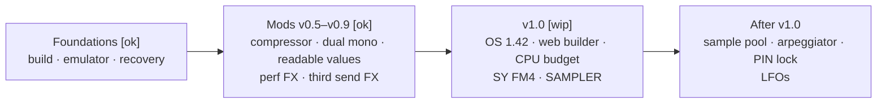

# SyntHack OS

**Make your Syntakt yours.**
Community mods and machines for the **Elektron Syntakt**, OS 1.42.
Each mod is a small patch on the stock OS from elektron.se. No firmware is distributed here.

It started with one need: a compressor on the master. The Syntakt sums in analog and its output is low and flat
next to other instruments. Driving the VCA of the FX send gave an analog compressor with digital control.
One idea changed the sound of the Syntakt. SyntHack is the structure that lets everyone add the next one.

> **Not affiliated with Elektron.** Modified firmware can make your device unusable and may void your warranty.
> Read the [recovery procedure](RECOVERY.md) before flashing. Use at your own risk.

**Status:** `v0.9.0` released (OS 1.41). `v1.0` (OS 1.42) in progress on `dev`: [status and release checklist](docs/status.md).

## Features

| Feature | Status | What it does |
|---|---|---|
| [Bus compressor](mods/master-comp) | `[ok]` | Compresses the tracks routed to the FX track. THR, ATK, REL, MUP, RAT, GR meter, ON/OFF on the FX track SYN page. Saved per pattern or global. |
| [Dual mono input](mods/dual-mono) | `[ok]` | EXTERNAL IN mono: IN L and IN R become two inputs. IN R page in the MIXER tab: level, DEL, REV, FX3 sends. Saved with the kit. |
| [Readable values](mods/readable-values) | `[ok]` | Hz, dB, ms, % instead of 0–127: filters, envelopes, levels, sends, delay, reverb. |
| [Performance FX](mods/perf-fx) | `[ok]` | Mod A (FUNC+15): keys 13–16 repeat, reverse or half-speed the pattern, all tracks. Quantized retrig (QNT). Saved with the kit. |
| [Third send FX](mods/fx3) | `[ok]` | SND3 on every track and the input into chorus, flanger, phaser or crusher. REVERB tab, page 2. Saved with the kit. |
| [Boot splash](mods/splash) | `[ok]` | Logo, version and optional name after the official intro. In every build. Boot time unchanged. |
| [Mod area](mods/modarea) | `[ok]` infra | 128 KB for mod code in a reserved block of the OS heap. |
| [Virtual parameters](mods/vparams) | `[ok]` infra | Mods add their own parameters to OS pages. |
| [Kit storage](mods/kitstore) | `[ok]` infra | 36 words of mod settings saved with the kit. |
| [Faster mixing](mods/fastmix) | `[ok]` infra | OS bus sums rewritten: same sound, ~3 200 cycles less per block. Added with the audio mods. |
| [Project storage](mods/projstore) | `[ok]` infra | 256 bytes of mod settings saved with the project. |
| [Web builder](web-builder) | `[wip]` | Build your `.syx` in the browser. Nothing uploaded. Same bytes as `build.py`. Not online yet. |
| [SY FM4](mods/sy-fm4) | `[wip]` machine | SY TONE becomes a 4-operator FM machine (Rxuting, MIT). Three SYN pages, algorithm drawn. Not tested on 1.42 hardware. |
| [SAMPLER](mods/sampler) | `[wip]` machine | SP TWINSHOT becomes the Digitakt's ONESHOT, WERP, REPITCH, SLICE. Not tested on hardware. Samples limited to ~5 s by the OS. |
| [Machine infra](mods/modarea7) | `[ok]` infra | [modarea7](mods/modarea7): ~125 KB for CPU #2 code. [syn-pages](mods/syn-pages): SYN pages per machine. [xparams](mods/xparams): 8 more parameters per track. |
| PIN lock | planned | PIN at power-on. OS reflash still recovers. |
| New LFO shapes · 3rd LFO / mod matrix | planned | |
| Arpeggiator · Euclidean UI | planned | |
| [Long samples](mods/long-samples) | `[wip]` | Samples longer than 5 s (Synfact's HZFS), sent from the web builder or Synfact's tool; one list with the stock samples, sample menu on the SAMPLER's knob D. Checked on the device: upload and playback |

## Known issues

| Issue | Status |
|---|---|
| UI lag with FX3 | `[wip]` cause: cache misses. Cache model: fx3 alone ~93 %, fx3 with master-comp and dual-mono ~96 %, every mod ~97 %; device measurement open ([fx3 CPU](docs/status.md#fx3-cpu)) |
| Samples cut at 5 s by the stock upload | `[wip]` [long-samples](mods/long-samples) (Synfact's HZFS): emulator-tested, device test open |
| Bus compressor: toggling *global* for the external input mixer also copies the compressor settings | known |
| v0.8.0 and earlier: projects with SP TWINSHOT samples can crash at boot ([#4](https://github.com/Angelo-politek/Synthack-OS/issues/4)) | fixed in v0.8.1. Flash the stock OS; projects and samples are not affected |

## Roadmap



## How it works

| Part | Role |
|---|---|
| `tools/unpack` | Unpack and repack the `.syx`. Wraps [elektron-firmware-tool](https://github.com/mischa85/elektron-firmware-tool). |
| `mods/<name>/patch.json` | Where to patch, SHA-256 of the expected original bytes, our new bytes. |
| `tools/build/build.py` | Stock OS + mods → verified `.syx`. Refuses a wrong OS, overlaps, protected sections. |
| `tools/emu` | ColdFire emulator: Unicorn + our EMAC model. Every mod is tested against the original code. `cycles.py` estimates audio CPU time with the 8 KB caches. |

## Documentation

| For | Doc |
|---|---|
| Musicians | [Users guide](web-builder/content/users.md): build, flash, use each mod, go back |
| Modders | [Modders guide](web-builder/content/modders.md): architecture, workflow, rules, CPU budget |
| Modders | [Create your mod](web-builder/content/create-mod.md): try it in the builder, submit it |
| Everyone | [Status](docs/status.md) · [RECOVERY.md](RECOVERY.md) · [CONTRIBUTING.md](CONTRIBUTING.md) · [LEGAL.md](LEGAL.md) · [docs/](docs) |

## Build your OS

Requirements: Python 3, WSL or Linux, your own `Syntakt_OS1.42.syx` ([firmware/README.md](firmware/README.md)).

```sh
bash tools/unpack/setup_eft.sh                 # once (WSL/Linux)
git config core.hooksPath tools/hooks          # once: blocks firmware files from commits
python tools/build/build.py --stock firmware/Syntakt_OS1.42.syx \
    mods/splash mods/dual-mono mods/master-comp mods/readable-values mods/perf-fx mods/fx3 -o out/synthack.syx
```

- Required mods (`modarea`, `vparams`, `kitstore`, `fastmix`) are added automatically.
- Optional: `--name YOURNAME` puts your name on the boot screen.
- Flash `out/synthack.syx` with Elektron Transfer: USB, **Drop** page.
- Go back: flash the stock OS the same way.

## Contributing

Issues and pull requests: see [CONTRIBUTING.md](CONTRIBUTING.md).
Don't post mods or instructions on Elektronauts. It is forbidden there. Use GitHub.

## License

GPL-2.0-or-later ([LICENSE](LICENSE)). Credits, third-party code and the earlier MIT releases: [NOTICE](NOTICE). See [LEGAL.md](LEGAL.md).
