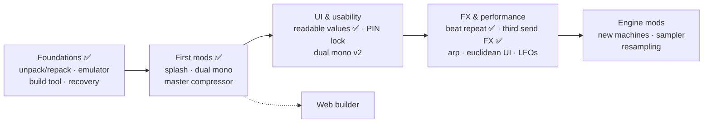

# SyntHack OS

Unofficial, modular firmware mods for the **Elektron Syntakt** (OS 1.41).
Each mod is a small patch applied to the stock OS you download from elektron.se — no firmware is distributed here.

> **Not affiliated with Elektron.** Modified firmware can make your device unusable and may void your warranty.
> Learn the [recovery procedure](RECOVERY.md) before flashing. Use at your own risk.

**Status:** `v0.8.1` — seven mods running on real hardware.

## Features

| Feature | Status | What it does |
|---|---|---|
| [Bus compressor](mods/master-comp) | ✅ v0.5.0 | Compressor on the **FX track bus**: it listens to and compresses the tracks routed to the FX track (send kick, snare, bass there and compress them together); tracks not routed to it are untouched. Digitakt-style curves. THR · ATK · REL · MUP · RAT + gain-reduction meter + ON/OFF switch on the FX track SYN page, values in dB / ms / ratio. Saved per pattern, or global with *SYN global*. |
| [Dual mono input](mods/dual-mono) | ✅ v0.5.0 | With EXTERNAL IN set to mono, **IN L** and **IN R** get independent levels on the External Mixer page. |
| [Boot splash](mods/splash) | ✅ v0.8.1 | "SyntHack" logo and version after the official intro. Boot time unchanged. |
| [Mod area](mods/modarea) | ✅ infra | 64 KB for mod code, stored compressed and unpacked at boot into a block reserved from the OS heap. |
| [Readable parameter values](mods/readable-values) | ✅ v0.5.0 | Hz, dB, ms and % instead of 0–127: filters, envelopes, levels, sends, delay and reverb, on every track and the FX track. Computed from the same data the DSP uses; analog parts measured on the device. |
| [Performance FX](mods/perf-fx) | ✅ v0.9 | Sequencer effects on **all tracks** (analog too): select Mod A (FUNC+15) and keys 13–16 play repeat (1/16 … 1 bar), reverse (1/8 … 1 bar) or half speed, resuming in time on release. Each key's effect is set in the Mod A setup page and saved with the kit. Replaces beat-repeat. Also **quantized retrig**: QNT in the Retrig setup page starts retrigs on the next step. |
| [Third send FX](mods/fx3) | ✅ v0.8.0 | **SND3** on every track (AMP page 1, next to DEL and REV; PAN moves to page 2) into a **chorus, flanger, phaser or crusher**, with its own page (REVERB tab, page 2) saved with the kit, and sends into the delay and the reverb; the return can be routed to the FX track (FUNC+FX, trig 13). |
| PIN lock | ⬜ planned | Optional PIN at power-on, as a theft deterrent. Recovery via OS reflash stays possible. |
| Dual mono v2 | ⬜ planned | Separate IN L / IN R pages with their own FX sends. |
| New LFO shapes · 3rd LFO / mod matrix | ⬜ planned | |
| Arpeggiator · Euclidean circle UI | ⬜ planned | |
| Resampling to SP TWINSHOT · advanced sampler | ⬜ planned | |
| New machines: RISER / DOWNFILTER, SY SWARM+ | ⬜ planned | Requires custom audio-engine code (CPU #2). |
| Web builder | ⬜ planned | Pick mods in the browser, build your `.syx` locally. |

## Known issues

- **v0.8.0 and earlier: projects with samples (SP TWINSHOT) can crash at boot** ([#4](https://github.com/Angelo-politek/Synthack-OS/issues/4)). The mod code lived in RAM that the OS uses when it loads samples. Fixed in v0.8.1: the mod code now lives in a block of the OS heap. Recovery for the old versions: flash stock 1.41; projects and samples are not affected.

## Roadmap



## How it works

- `tools/unpack` — unpack/repack the `.syx` (wraps [elektron-firmware-tool](https://github.com/mischa85/elektron-firmware-tool)).
- `mods/<name>/patch.json` — *where* to patch, a hash of the expected original bytes, and **our** new bytes.
- `tools/build/build.py` — stock OS + chosen mods → verified `.syx` (refuses wrong OS, overlaps, protected sections).
- `tools/emu` — ColdFire emulator (Unicorn + our EMAC model). Every mod is tested against the original code before flashing.

Technical findings: [docs/](docs). Writing your own mod: [docs/modding-guide.md](docs/modding-guide.md).

## Build your OS

Requires Python 3, WSL/Linux and your own `Syntakt_OS1.41.syx` (see [firmware/README.md](firmware/README.md)).

```sh
bash tools/unpack/setup_eft.sh                 # once (WSL/Linux)
git config core.hooksPath tools/hooks          # once: blocks firmware files from commits
python tools/build/build.py --stock firmware/Syntakt_OS1.41.syx \
    mods/splash mods/dual-mono mods/modarea mods/vparams mods/master-comp mods/readable-values mods/perf-fx \
    mods/fx3 -o out/synthack.syx
```

Flash `out/synthack.syx` with Elektron Transfer (USB, *Drop* page). To go back, flash the stock OS the same way.

## Contributing

Issues and pull requests are welcome — see [CONTRIBUTING.md](CONTRIBUTING.md).
Please don't post mods or instructions on Elektronauts (forbidden there); use GitHub.

## License

MIT for everything in this repository ([LICENSE](LICENSE)). See [LEGAL.md](LEGAL.md).
